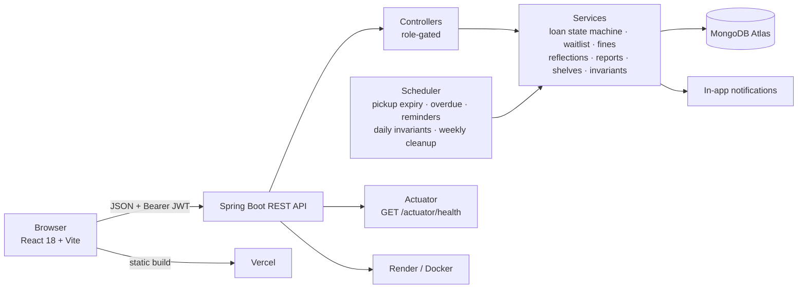
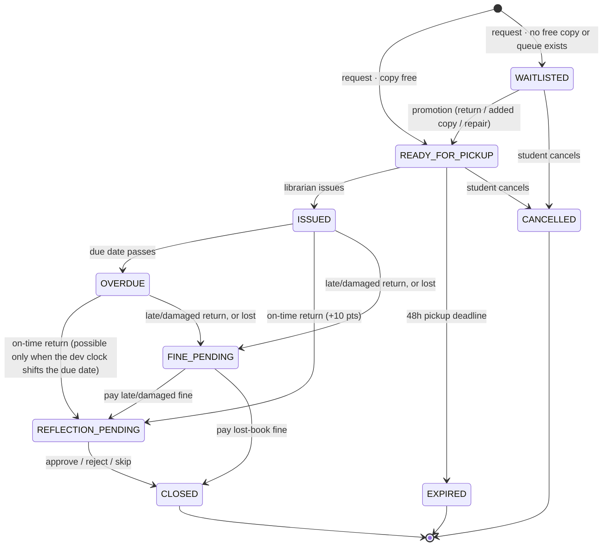

# SmartLib — University Library Management System

> **Iteration 4 (final)** — a demo-ready, submission-ready library platform with a visual shelf map,
> librarian reports, a shared design system, concurrency/edge-case hardening, production configuration,
> and a tested full loan lifecycle.

SmartLib is a full-stack university library app. Students search the catalogue, locate physical books on
a floor map, request copies, join FIFO waitlists, pay fines, submit reading reflections and earn points.
Librarians issue and return books, manage shelves/books/copies, review reflections and read operational
reports.

---

## 1. Feature overview

### For students
- Search/filter the catalogue with **server-side pagination and sorting**; switch between card and table views.
- See live availability, waitlist size and the book's **shelf code**, with a "Locate on map" link.
- **Visual library map** (`/map`) — a colour-coded 4×3 floor grid; click a shelf to list its books, or open
  `/map?shelf=A2` to land on a highlighted shelf.
- Request a copy (atomic reservation) or join the **FIFO waitlist**; pickup countdown turns red under 6 hours.
- My loans with tabs, reflection composer, cancel actions and confirm dialogs.
- My fines with late/damaged/lost breakdowns and simulated payment.
- **Reading reflections** (+20 points when approved), skip option, review notes.
- Personalised **recommendations**, in-app **notifications**, profile/preferred subjects.
- **Leaderboard** (`/leaderboard`) — top 10 by points, current student highlighted; names and points only.
- Light/dark theme that follows the OS by default and persists the user's choice.

### For librarians
- Dashboard with ready-for-pickup, issued, overdue, reflections, fines and copy-status counts.
- Circulation: issue reserved copies, process returns as good/damaged, mark lost, release expired holds.
- **Shelves** (`/librarian/shelves`): create/edit/delete shelves in a row/column grid; non-empty shelves
  return **409**. Full shelves reject book assignment.
- **Books & copies**: CRUD, shelf assignment, add copies, repair damaged copies, view holders.
- Reflections review, waitlist inspection, user administration, fines audit.
- **Reports** (`/librarian/reports`): overdue, popular books, circulation line chart, fines breakdown,
  waitlist pressure, inventory, student leaderboard, CSV download per report.
- Demo time controls (dev profile + `VITE_DEV_TOOLS=true`) for overdue/pickup-expiry walkthroughs and
  one-click invariant checks/repair.

### Public
- Landing page explaining SmartLib, with Login and Register.
- Friendly 404 page and a global error boundary.

---

## 2. Tech stack

| Layer | Technology |
|---|---|
| Backend | Java 21, Spring Boot 3.3.5, Spring Web, Spring Data MongoDB, Spring Security (JWT), Bean Validation, Actuator |
| Database | MongoDB Atlas (M0/free tier compatible) |
| Frontend | React 18, Vite 6, React Router 6, Recharts, lucide-react, plain CSS design tokens |
| Tests | JUnit 5 + Mockito + AssertJ (backend), Vitest + React Testing Library (frontend) |
| Delivery | Docker/Docker Compose, GitHub Actions, Render, Vercel |

---

## 3. Architecture



Key design points:
- Stateless JWT authentication; identity always comes from the token, never from request bodies.
- Atomic copy reservation (`findAndModify AVAILABLE → RESERVED`) and FIFO queue promotion
  (`findAndModify WAITING → FULFILLED`) prevent double allocation.
- Every loan/reflection/fine state change is a **conditional update** (`_id + expected status`). A zero
  matched count returns **409**, so double-clicks and multiple scheduler instances cannot double-apply.
- Reports use MongoDB aggregation pipelines (`$match`, `$group`, `$lookup`, `$dateToString`), not
  load-all-and-loop.
- Atlas M0 has no multi-document transactions; writes are ordered (loan first, then copy/queue) and a
  repair routine handles stuck queues.

### Loan state machine (matches the implementation)



> Reflections store their own `PENDING → APPROVED/REJECTED` status; the loan closes when the reflection
> is approved/rejected or the student skips. Rejecting a reflection closes the loan without points.

---

## 4. Project structure

```
smartlib/
├── backend/
│   ├── Dockerfile · .dockerignore
│   ├── pom.xml
│   └── src/main/java/com/smartlib/
│       ├── config/        security, JWT, rate limiter, seeder, scheduler, invariants
│       ├── controller/    auth, books, shelves, loans, waits, fines, reflections,
│       │                  reports, leaderboard, notifications, dashboards, dev
│       ├── dto/           request/response records and page envelope
│       ├── model/         User, Book, Shelf, Copy, Loan, WaitlistEntry, Fine,
│       │                  Reflection, Notification + enums
│       ├── repository/    Spring Data MongoDB repositories
│       └── service/       business logic and reports
├── frontend/
│   ├── Dockerfile · nginx.conf · vercel.json
│   └── src/
│       ├── components/ui/ shared design-system components
│       ├── context/       Auth, Theme, Toast
│       ├── pages/         public, student, librarian
│       └── test/          Vitest + RTL tests
├── .github/workflows/ci.yml
├── docker-compose.yml
├── .env.example
├── README.md · API.md · DEPLOYMENT.md
├── DEMO_SCRIPT.md · CHANGES_FROM_PROPOSAL.md
```

---

## 5. Run locally

### Prerequisites
Java 21, Maven 3.9+, Node.js 22+, npm, and a MongoDB Atlas connection string.

### Environment

```bash
cd smartlib
cp .env.example .env     # fill in MONGODB_URI and JWT_SECRET
set -a && source .env && set +a
```

The backend requires `MONGODB_URI` and `JWT_SECRET` (minimum 32 characters; startup fails otherwise).
Use a **fresh database** for a clean Iteration 4 seed. The seeder only runs when collections are empty.

### Backend

```bash
cd backend
export JAVA_HOME=/opt/homebrew/opt/openjdk@21   # adjust to your JDK 21
SPRING_PROFILES_ACTIVE=dev \
PORT=8080 \
SPRING_DATA_MONGODB_DATABASE=smartlib4 \
JAVA_HOME="$JAVA_HOME" mvn spring-boot:run
```

- `dev` profile: `/api/dev/*` enabled and demo data seeded automatically.
- `prod` profile: dev endpoints disabled, INFO logs, demo seeding off unless `APP_SEED_DEMO=true`.
- `PORT` is overridable because some shells/hosts set it; Docker/Render use it directly.
- Health check: `curl http://localhost:8080/actuator/health`.

### Frontend

```bash
cd frontend
npm install          # first time
VITE_DEV_TOOLS=true npm run dev
```

Open **http://localhost:5173**. `VITE_API_URL` defaults to `http://localhost:8080/api`;
set it for a deployed API. `VITE_DEV_TOOLS=true` shows the demo panel on Circulation.

### Docker Compose (optional)

```bash
cd smartlib
cp .env.example .env   # fill MONGODB_URI/JWT_SECRET
docker compose up --build
```

Frontend: `http://localhost:3000` · backend: `http://localhost:8080`. MongoDB stays on Atlas.
Docker was **not installed on the development machine**, so the image/compose build is provided but
marked **NOT VERIFIED** in the acceptance checklist. `DEPLOYMENT.md` has the exact Render/Vercel steps.

---

## 6. Environment variables

| Variable | Required | Used by | Purpose |
|---|---|---|---|
| `MONGODB_URI` | yes | backend | Atlas connection string |
| `JWT_SECRET` | yes | backend | HS256 signing key, ≥32 chars |
| `SPRING_PROFILES_ACTIVE` | prod yes | backend | `dev` locally, `prod` in production |
| `SPRING_DATA_MONGODB_DATABASE` | no | backend | Database name (default `smartlib`) |
| `PORT` | host-dependent | backend | HTTP port (default 8080) |
| `APP_CORS_ALLOWED_ORIGIN` | prod yes | backend | Comma-separated browser origins |
| `APP_SEED_DEMO` | no | backend | Seed demo data; dev profile forces `true` |
| `APP_RATE_LIMIT_ENABLED` | no | backend | Default `true`, 10 attempts/min/IP |
| `VITE_API_URL` | deploy yes | frontend build | API base including `/api` |
| `VITE_DEV_TOOLS` | no | frontend build | `true` shows demo controls |

Never commit `.env` or real secrets. `.env.example` contains placeholders only.

---

## 7. Demo accounts & seed data

All demo accounts use password **`Password123`**.

| Role | Accounts |
|---|---|
| Students | `aarav@smartlib.test`, `diya@smartlib.test`, `kabir@smartlib.test`, `isha@smartlib.test`, `neha@smartlib.test`, `rohan@smartlib.test` |
| Librarians | `meera@smartlib.test`, `ravi@smartlib.test` |

The dev seed creates:
- **12 shelves** in a 4×3 grid across six sections, all 30 books assigned.
- **30 books / 55 copies** across Computer Science, Mathematics, Physics, Literature, History, Economics.
- **6 students + 2 librarians** with points, preferred subjects and a believable history.
- Loans in every meaningful state (ISSUED, OVERDUE, READY_FOR_PICKUP, WAITLISTED, REFLECTION_PENDING,
  FINE_PENDING, CLOSED), approved/pending reflections, paid/pending fines, and fulfilled waitlist entries.
- Isha and Rohan intentionally have pending fines so "pending fines block requests" is demonstrable.
- Aarav has a waitlist entry on *Concrete Mathematics*; Diya has a pending reflection.

Students register through the UI/API; librarians can create additional staff accounts on Users.

---

## 8. API

Full request/response reference: **[API.md](API.md)**.

- All `/api/**` routes require `Authorization: Bearer <token>` except `/api/auth/login|register`.
- Role checks: `STUDENT` or `LIBRARIAN`; `401`/`403` return the same JSON error shape as other errors.
- Books and loans return a page envelope:
  `{items, page, size, totalItems, totalPages}`.
- Main resources: `/api/books`, `/api/shelves`, `/api/loans`, `/api/fines`, `/api/reflections`,
  `/api/notifications`, `/api/recommendations`, `/api/dashboard/*`, `/api/leaderboard`, `/api/reports/*`.
- Reports accept optional `from`/`to` ISO dates (default last 30 days). CSV:
  `GET /api/reports/export?type=overdue|fines|popular|inventory`.
- Dev-only (profile `dev`): `/api/dev/loans/{id}/set-due-date`, `/set-pickup-deadline`,
  `/api/dev/run-jobs`, `/api/dev/invariants`, `/api/dev/repair`.

---

## 9. Tests

```bash
# Backend unit suite (88 tests)
cd backend
JAVA_HOME=/opt/homebrew/opt/openjdk@21 mvn test

# Optional real-Mongo lifecycle + 20-way last-copy race (drops smartlib_it)
SMARTLIB_IT_URI="$MONGODB_URI" \
JAVA_HOME=/opt/homebrew/opt/openjdk@21 mvn -Dtest=FullLifecycleIT test

# Frontend (28 tests) + production build
cd ../frontend
npm test
npm run build
```

The default backend suite covers:
shelf capacity/delete rules, report aggregations and CSV headers, pagination envelopes, rate limiting,
conditional-update race losers, password-hash serialization, loan/waitlist/fine/reflection state machines,
scheduler idempotency, recommendations and book/copy management.

The frontend suite covers login validation, protected-route guards, status badge semantics, the countdown
(including the <6h urgent state), and the books page loading/empty/error/data/card-table states.

CI: `.github/workflows/ci.yml` runs `mvn test`, `npm test` and `npm run build` on push/PR.

---

## 10. Reports and shelf map notes

- **Shelf capacity is measured in books**, not copies. `PATCH /api/books/{id}/shelf` validates the shelf
  exists and is not full; assigning also moves all copies to the same shelf.
- Deleting a shelf with books returns **409**; deleting an empty shelf is allowed.
- The map is a CSS-grid floor plan (`row`, `column`) rather than a calibrated building CAD drawing.
- Popular-books and waitlist reports use `$toObjectId` before `$lookup` because loan/waitlist
  `bookId`s are strings while MongoDB `_id`s are ObjectIds.
- Waitlist queue length is current; the date range only scopes the fulfilled-entry average wait time.
- Inventory reports zero-available titles; fines reports imposed/collected/outstanding by reason.

---

## 11. Design system & accessibility

- CSS variables and a calm academic palette: deep blue primary, warm amber accent, neutral greys.
- Inter loaded from Google Fonts with a system fallback; light/dark tokens; persisted theme.
- Shared components under `frontend/src/components/ui`: Button, Input/Select/Textarea, Card, Badge, Modal,
  ConfirmDialog, Toast, Tabs, Table, Pagination, EmptyState, Skeleton, Spinner, Tooltip, PageHeader.
- Responsive at 360/768/1280 px; hamburger navigation; tables scroll horizontally.
- Labels on inputs, visible focus rings, modal focus trap/Esc, aria-live toasts, `role="timer"` countdowns,
  text/icon status labels (never colour alone), reduced-motion support, friendly 404 and error boundary.
- All data views implement loading, empty and error states.

---

## 12. Screenshots (placeholders)

Capture these during the demo and replace this list with images in `docs/screenshots/`:

| File | Suggested shot |
|---|---|
| `landing.png` | Logged-out hero + features |
| `map.png` | `/map?shelf=A2` highlighted shelf and book list |
| `catalogue.png` | Books page cards/table, filters and pagination |
| `reports.png` | Circulation line chart, popular bars and fines donut |
| `circulation.png` | Ready-for-pickup and issued loans with dev panel |
| `leaderboard.png` | Top 10 with the current student highlighted |
| `dark-mobile.png` | Dark theme at 360px with hamburger open |

---

## 13. Documentation

- [API.md](API.md) — endpoint and schema reference
- [DEPLOYMENT.md](DEPLOYMENT.md) — Atlas, Render, Vercel, CORS, seed and smoke tests
- [DEMO_SCRIPT.md](DEMO_SCRIPT.md) — 10–12 minute evaluator walkthrough
- [CHANGES_FROM_PROPOSAL.md](CHANGES_FROM_PROPOSAL.md) — honest differences from the original proposal

---

## 14. Assumptions and known limitations

- **In-app notifications only**; no email/SMS provider is wired.
- **Simulated payments**; no payment gateway. Fines are currency units displayed as ₹.
- **No multi-branch libraries**; the shelf map models one floor with 4 rows × 3 columns.
- **No transactions** on Atlas M0; ordered writes plus the invariant checker/repair routine are used.
- Rate limiting is per backend instance (in-memory). A multi-instance deployment should move the buckets
  to Redis or the platform edge.
- JWT is stored in `localStorage` for demo simplicity; a hardened production app would prefer secure
  httpOnly cookies/refresh rotation.
- Demo seed data is intentionally fictional.
- Docker image/compose build could not be executed on the development machine (Docker absent).
- Playwright/Cypress E2E was not added; the equivalent flows are covered by the gated Spring integration
  test and the documented manual demo script.
